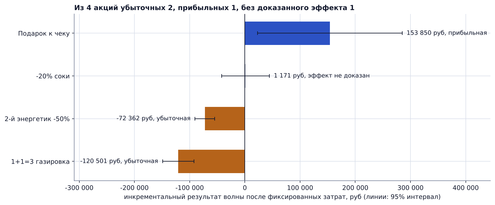
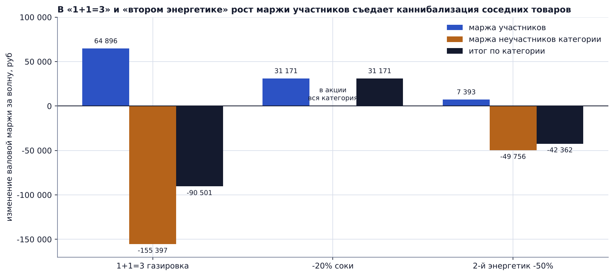
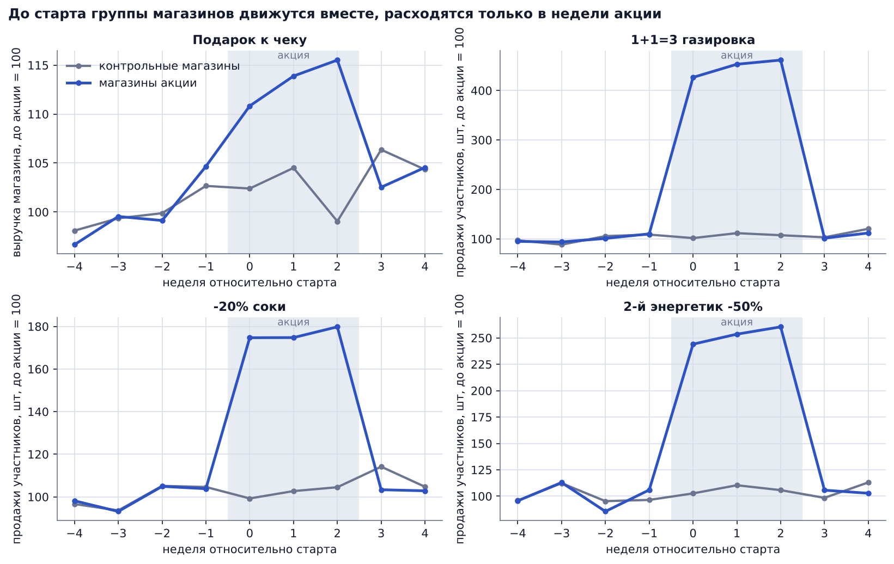
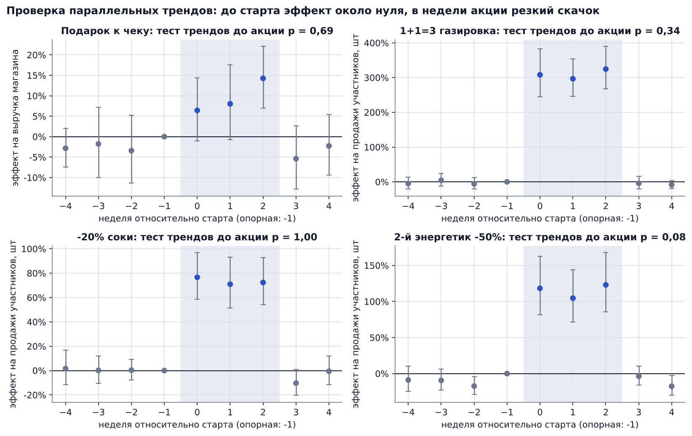
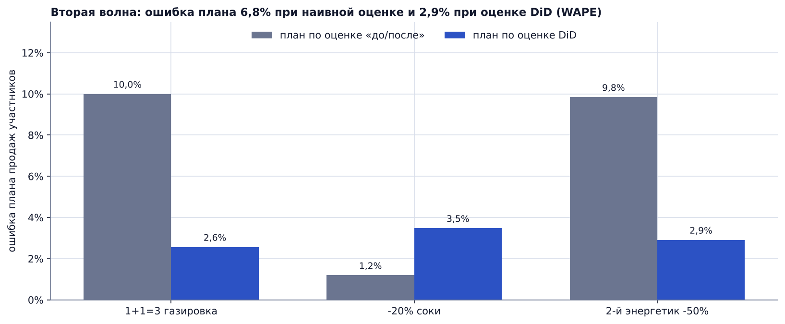

# Оценка эффективности промоакций: Diff-in-Diff по чекам 1С

*Estimating the incremental profit of retail promotions with Difference-in-Differences on receipt-level data (synthetic, 1C-style export).*

## Бизнес-задача

Сеть из 20 магазинов провела четыре акции с разными механиками. Отчёт «продажи в акцию против прошлых недель» показывал рост везде, а маржа сети при этом не росла. Нужно было ответить на три вопроса:

1. Какие акции принесли дополнительную прибыль, а какие её проели?
2. Где теряются деньги: в скидке, в каннибализации соседних товаров или в подарках?
3. Как точнее планировать продажи следующих волн акций?

## Данные

Синтетические данные, повторяющие построчную выгрузку чеков из 1С. Данные заказчиков конфиденциальны, поэтому структура и закономерности воспроизведены на сгенерированной выборке.

| Параметр | Значение |
|---|---|
| Период | 05.01.2026-19.07.2026, 28 недель |
| Магазины | 20 |
| Товары | 300 SKU, 8 категорий, упор на напитки |
| Чеки | 457 307 чеков, 1 411 329 строк |
| Поля | receipt_id, datetime, store_id, sku_id, category, qty, price, discount, cost, promo_id |

Акции первой волны (каждая в 8 случайных магазинах, остальные 12 служат контрольной группой):

| Код | Акция | Механика |
|---|---|---|
| P3 | Подарок к чеку от 800 руб | подарок себестоимостью 45 руб к чеку от порога |
| P1 | 1+1=3 на газированные напитки | третья бутылка из 10 SKU бесплатно |
| P2 | -20% на соки и нектары | скидка на всю категорию |
| P4 | Второй энергетик за полцены | 8 SKU, второй товар -50% |

Вторая волна P1, P2 и P4 прошла в других магазинах и используется для проверки точности планирования. Пример строк выгрузки: [`data/sample/checks_sample.csv`](data/sample/checks_sample.csv).

## Подход

**Почему не «до/после».** Летом напитки растут сами по себе. Рост в недели акции складывается из сезона и эффекта акции, и наивное сравнение приписывает акции весь рост.

**Diff-in-Diff.** Магазины с акцией сравниваются с контрольными магазинами за те же недели:

`y = b * (магазин акции x недели акции) + эффект магазина + эффект недели`

- эффект магазина убирает разницу в масштабе точек, эффект недели убирает сезон и общие события;
- окно: 4 недели до старта и 3 недели акции, ошибки кластеризованы по магазинам;
- для товарных акций отдельно оцениваются участники, неучастники той же категории (каннибализация) и прочие категории (эффект на корзину).

**Проверки.**
- параллельные тренды: event study по неделям и совместный тест, что эффекты до старта равны нулю;
- качество витрин: 6 SQL-проверок (сверка выручки с чеками, скидки только в магазинах и неделях акции и т.д.).

**Инкрементальный P&L.** Эффект на маржу всей категории (в нём уже учтены скидка, рост участников и каннибализация) плюс значимый эффект на прочие категории, минус фиксированные затраты волны 30 000 руб. Для акции на чек: эффект на маржу магазина с учётом себестоимости подарков.

## Результаты

### Итог по акциям первой волны

| Акция | Продажи участников | Каннибализация, выручка соседних SKU | Маржа категории | Результат волны, руб | Статус |
|---|---|---|---|---|---|
| Подарок к чеку от 800 руб | чеков +5,1%, средний чек +6,0% | | маржа магазина +6,6% | **+153 850** | прибыльная, p = 0,006 |
| 1+1=3 на газированные напитки | +319% | -33,6% | -14,3% | **-120 501** | убыточная, p < 0,001 |
| -20% на соки и нектары | +73,1% | вся категория в акции | +4,8% | **+1 171** | эффект не доказан, p = 0,158 |
| Второй энергетик за полцены | +135,6% | -37,7% | -16,8% | **-72 362** | убыточная, p < 0,001 |

- Две акции из четырёх убыточны: вместе они потеряли **192 863 руб** за одну волну.
- Итог первой волны по всем акциям: **-37 842 руб** при 1 184 033 руб, розданных скидками и подарками.
- На каждые 100 руб скидок и подарков: «подарок к чеку» вернул +128 руб, «1+1=3» потерял 26 руб, «второй энергетик» потерял 46 руб.



### Куда уходит маржа

Участники «1+1=3» и «второго энергетика» продаются в разы лучше, но покупатели в основном переключаются с соседних товаров категории, а скидка достаётся и тем, кто купил бы без акции.



### Проверка допущений

До старта магазины двух групп движутся вместе, расхождение появляется только в недели акции. Совместный тест не отвергает параллельные тренды ни для одной акции (p-value: подарок к чеку 0,69; 1+1=3 0,34; соки 1,00; второй энергетик 0,08). У «второго энергетика» значение ближе к границе, поэтому вывод по нему стоит подтвердить на следующей волне.




### Точность планирования второй волны

План = база без акции x (1 + эффект из первой волны). База одинакова для обоих подходов, различается только оценка эффекта.

| Акция | Ошибка плана, «до/после» | Ошибка плана, DiD |
|---|---|---|
| 1+1=3 на газированные напитки | 10,0% | 2,6% |
| -20% на соки и нектары | 1,2% | 3,5% |
| Второй энергетик за полцены | 9,8% | 2,9% |
| **Итого, WAPE** | **6,8%** | **2,9%** |

Наивная оценка завышает план там, где акция пришлась на сезонный рост напитков. По сокам, где сезонность слабее, наивный план случайно оказался точнее, но в сумме DiD снижает ошибку плана в 2,3 раза.



## Что это даёт бизнесу

1. **Снять или переделать «1+1=3» и «второй энергетик за полцены».** Механики раздают маржу покупателям, которые и так брали эти категории. Если механика нужна для трафика, оставить её только на товары без близких заменителей.
2. **Перевести бюджет в «подарок к чеку».** Механика растит и трафик, и средний чек и окупает подарки.
3. **Протестировать на соках скидку 10-15% вместо 20%.** Рост продаж есть, но при текущей глубине скидки маржа не растёт.
4. **Планировать волны по оценке DiD.** Сезон перестаёт попадать в эффект акции, и план закупки под акцию становится точнее.

Сводный отчёт для коммерческой службы: [`reports/promo_summary.xlsx`](reports/promo_summary.xlsx) (листы «Общие итоги», «Акции», «Эффекты DiD», «Планирование»).

## Структура репозитория

```
promo-effectiveness-did/
├── data/
│   ├── reference/          справочники: товары, магазины, календарь акций, участники
│   ├── mart/               витрины, собранные SQL-скриптами
│   ├── sample/             500 строк выгрузки чеков для примера
│   └── raw/                checks.parquet (создаётся генератором, в git не хранится)
├── sql/
│   ├── 01_mart_store_week.sql     магазин x неделя
│   ├── 02_mart_group_week.sql     магазин x неделя x товарная группа акции
│   ├── 03_mart_promo_spend.sql    скидки и подарки по акциям
│   └── 04_checks.sql              проверки качества витрин
├── src/
│   ├── generate_data.py    генерация чеков
│   ├── mart.py             запуск SQL в DuckDB и проверки
│   ├── did.py              модель DiD, event study, наивная оценка
│   ├── analysis.py         эффекты, P&L, точность планирования
│   ├── plots.py            графики
│   ├── report_excel.py     Excel-отчёт
│   └── run_pipeline.py     полный пересчёт
├── notebooks/
│   └── 01_promo_did.ipynb  анализ с пояснениями
└── reports/
    ├── figures/            графики
    ├── *.csv               таблицы результатов
    └── promo_summary.xlsx  отчёт
```

## Как запустить

```bash
python -m venv .venv && source .venv/bin/activate
pip install -r requirements.txt
python -m src.run_pipeline
```

Пересчёт занимает около 20 секунд: генерация чеков, витрины, модели, графики и Excel-отчёт. Генератор использует фиксированный seed, поэтому цифры воспроизводятся. Ноутбук `notebooks/01_promo_did.ipynb` читает готовые витрины и проходит по анализу шаг за шагом.

## Стек

Python (pandas, statsmodels), SQL (DuckDB), matplotlib, openpyxl, Jupyter.
